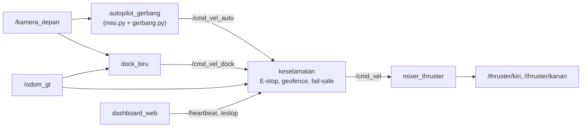

# asv_sim — Simulasi ASV untuk KKI 2026

Simulasi kapal otonom (ASV, *Autonomous Surface Vessel*) di **ROS 2 Jazzy + Gazebo Harmonic**, mengikuti pedoman lomba 2026:

- kapal berangkat dari dermaga, melewati **10 pasang pelampung merah-hijau**, lalu merapat ke **bola biru** di dermaga finish, semuanya otonom;
- gambar **permukaan** dan **bawah air** dikirim real-time ke **dashboard web** (posisi, heading, kecepatan);
- **emergency stop**, **geofence**, dan **fail-safe saat sinyal hilang**.

Pelindung baling-baling adalah komponen fisik dan tidak disimulasikan.

## Cara kerja singkat



Perintah dari `dock_biru` didahulukan atas autopilot, dan `keselamatan` mematikan thruster bila ada alasan berhenti.

## 1. Pemasangan dari nol

Panduan ini untuk yang **baru memasang ROS 2** dan belum punya Gazebo. Sistem yang dipakai: **Ubuntu 24.04** (asli atau WSL2 di Windows) dan **ROS 2 Jazzy**.

> Belum punya Ubuntu atau ROS 2? Di Windows: buka PowerShell, jalankan `wsl --install -d Ubuntu-24.04`, restart, lalu ikuti
> [panduan resmi ROS 2 Jazzy](https://docs.ros.org/en/jazzy/Installation/Ubuntu-Install-Debs.html).

### 1.1 Pastikan ROS 2 bekerja

```bash
source /opt/ros/jazzy/setup.bash
printenv ROS_DISTRO          # harus: jazzy
ros2 run demo_nodes_cpp talker   # Ctrl+C untuk berhenti
```

### 1.2 Pasang Gazebo, jembatan ROS–Gazebo, dan pustaka yang dibutuhkan

```bash
sudo apt update
sudo apt install -y ros-jazzy-ros-gz python3-opencv python3-numpy python3-yaml \
                    python3-colcon-common-extensions git
```

`ros-jazzy-ros-gz` membawa **Gazebo Harmonic** beserta `ros_gz_sim` dan `ros_gz_bridge`. Uji bahwa Gazebo bisa terbuka:

```bash
gz sim shapes.sdf
```

Jendela Gazebo harus muncul (pertama kali bisa lambat). Tutup dengan Ctrl+C di terminal.
Di WSL, jendela tampil lewat WSLg (Windows 11 atau Windows 10 yang sudah diperbarui; jalankan `wsl --update` bila tidak muncul).

### 1.3 Ambil kode

Repositori ini **private**. Pemilik repositori harus mengundang akun GitHub Anda lebih dulu (Settings → Collaborators). Saat `git clone`, GitHub meminta **token akses pribadi** (bukan kata sandi akun), atau Anda bisa masuk dulu dengan `gh auth login`.

```bash
mkdir -p ~/ros2_ws/src
cd ~/ros2_ws/src
git clone https://github.com/anip1/asv_sim.git
```

### 1.4 Build

```bash
cd ~/ros2_ws
source /opt/ros/jazzy/setup.bash
colcon build --symlink-install --packages-select asv_sim
source install/setup.bash
```

Agar tidak mengetik `source` setiap membuka terminal:

```bash
echo "source /opt/ros/jazzy/setup.bash" >> ~/.bashrc
echo "source ~/ros2_ws/install/setup.bash" >> ~/.bashrc
```

Dengan `--symlink-install`, perubahan pada file Python, launch, dan config langsung berlaku tanpa build ulang. **File baru** tetap perlu `colcon build` lagi.

## 2. Menjalankan

```bash
ros2 launch asv_sim pedoman.launch.py
```

Tunggu sekitar satu menit sampai jendela Gazebo muncul dan kapal mulai bergerak. Lalu buka dashboard di peramban: **http://localhost:8080**.

Urutan yang wajar: kapal melewati gerbang 1 sampai 10 → `IMAGING_PERMUKAAN` → `IMAGING_BAWAH_AIR` → `DOCKING` → `SELESAI`. Di sekitar x ≈ 31,5 m node `dock_biru` mengambil alih dan merapat ke bola biru (`CARI` → `DEKATI` → `SANDAR` → `SELESAI`).

Tanpa fitur pedoman (hanya dunia, mixer, dan autopilot): `ros2 launch asv_sim sim.launch.py`.

### Tombol di dashboard

| Tombol | Fungsi |
|---|---|
| **E-STOP** | Mematikan thruster dan menghentikan misi. |
| **RESET** | Melepas kunci E-STOP/geofence. Misi tetap menunggu. |
| **Mulai ulang misi** | Misi baru dari gerbang 1 (dipakai setelah E-STOP atau selesai). |
| **Putus/sambung sinyal (simulasi)** | Menghentikan *heartbeat* untuk menguji fail-safe `LINK_HILANG`. |
| **Hapus jejak** | Membersihkan garis lintasan di peta. |

**Reset di Gazebo** (ikon ↻) otomatis mengulang misi dari awal; tidak perlu launch ulang.

### Status pengaman (`/keselamatan/status`)

| Status | Arti |
|---|---|
| `OK (auto)` / `OK (dock)` | Aman; perintah dari autopilot atau docking diteruskan. |
| `ESTOP` | E-stop ditekan. Lepas dengan tombol RESET. |
| `PAGAR` | Kapal keluar geofence. Pindahkan kapal ke dalam, lalu RESET. |
| `LINK_HILANG` | Tidak ada *heartbeat* (dashboard mati atau sinyal diputus). |
| `POSISI_HILANG` | Tidak ada data `/odom_gt`. |

## 3. Perintah yang sering dipakai

```bash
ros2 topic echo /misi/status --once          # status misi (mis. LEWAT gerbang 3/10)
ros2 topic echo /dock/status --once          # status docking
ros2 topic echo /keselamatan/status --once   # status pengaman
ros2 topic hz /kamera_depan                  # laju kamera (normal 2–8 Hz di WSL)

# ubah parameter saat jalan (tanpa restart)
ros2 param set /keselamatan pagar "[-4.0, 40.5, -5.0, 5.0]"   # x_min x_maks y_min y_maks
ros2 param set /dock_biru jarak_henti 0.6                     # jarak berhenti dari bola (m)
ros2 param set /keselamatan laju_w 0.0                        # matikan penghalus belokan
```

Catatan: `ros2 topic echo` tepat setelah launch kadang menjawab *"does not appear to be published yet"*; tunggu beberapa detik lalu ulangi.

## 4. Struktur repositori

```
asv_sim/
├── asv_sim/                    # kode Python (node ROS)
│   ├── autopilot_gerbang.py    # kamera → pelampung → gerbang → mesin status misi → /cmd_vel_auto
│   ├── gerbang.py              # memasangkan pelampung merah-hijau menjadi gerbang
│   ├── misi.py                 # mesin status misi (tanpa ROS, mudah diuji)
│   ├── mixer_thruster.py       # /cmd_vel → daya thruster kiri/kanan
│   ├── keselamatan.py          # E-stop, geofence, fail-safe sinyal, pembatas laju
│   ├── dock_biru.py            # merapat ke bola biru dari kamera
│   └── dashboard_web.py        # dashboard web di port 8080
├── launch/
│   ├── sim.launch.py           # Gazebo + jembatan + mixer + autopilot
│   └── pedoman.launch.py       # sim.launch.py + keselamatan + docking + dashboard
├── config/
│   ├── jembatan.yaml           # topik yang dijembatani ROS ↔ Gazebo
│   └── pedoman.yaml            # parameter keselamatan, docking, dan dashboard
├── worlds/
│   ├── kolam_asv.sdf           # dunia Gazebo (sudah lengkap dengan dermaga dan bola biru)
│   └── kolam_asv.sdf.asli      # dunia sebelum ditambah elemen pedoman (sumber untuk tambah_pedoman.py)
└── tools/
    ├── buat_dunia.py           # pembuat dunia dasar (gerbang dan kapal)
    ├── tambah_pedoman.py       # menambah dermaga, bola biru, pagar, dan kamera bawah air ke dunia
    └── pasang.py               # hanya untuk menempelkan fitur pedoman ke paket lama; tidak perlu setelah clone
```

## 5. Topik dan layanan penting

| Nama | Tipe | Keterangan |
|---|---|---|
| `/kamera_depan`, `/kamera_bawah` | `sensor_msgs/Image` | Kamera permukaan (640×480) dan bawah air (320×240, 1 Hz). |
| `/odom_gt` | `nav_msgs/Odometry` | Pose benar dari Gazebo (dipakai pengaman, docking, dan dashboard). |
| `/cmd_vel_auto` | `geometry_msgs/Twist` | Keluaran autopilot. |
| `/cmd_vel_dock` | `geometry_msgs/Twist` | Keluaran docking (didahulukan). |
| `/cmd_vel` | `geometry_msgs/Twist` | Keluaran `keselamatan` ke mixer. |
| `/thruster/kiri`, `/thruster/kanan` | `std_msgs/Float64` | Daya thruster ke Gazebo. |
| `/misi/status`, `/misi/mulai` | `String`, `Empty` | Status misi dan perintah mulai. |
| `/dock/status` | `String` | `MENUNGGU`, `CARI`, `DEKATI`, `SANDAR`, `SELESAI`. |
| `/heartbeat`, `/estop` | `Empty`, `Bool` | Dari dashboard ke `keselamatan`. |
| `/safety/estop`, `/safety/reset` | `Bool`, `Empty` | Jalur pengaman milik mixer dan autopilot. |
| `/keselamatan/reset` | `std_srvs/Trigger` | Melepas kunci pengaman. |

## 6. Mengubah dunia

Kalau `worlds/kolam_asv.sdf` dibuat ulang dengan `tools/buat_dunia.py`, tambahkan lagi elemen pedoman:

```bash
cd ~/ros2_ws/src/asv_sim
python3 tools/buat_dunia.py            # menghasilkan kolam_asv.sdf dasar (cek opsinya di dalam skrip)
python3 tools/tambah_pedoman.py        # dermaga, bola biru, pagar, kamera bawah air, pedoman.yaml
gz sdf -k worlds/kolam_asv.sdf         # harus menampilkan "Valid."
```

Opsi `tambah_pedoman.py`: `--pagar X0 X1 Y0 Y1` (ukuran arena), `--diameter-bola`, `--rate-bawah`, `--tanpa-kamera-bawah`. Skrip ini aman dijalankan berulang.

## 7. Pemecahan masalah

| Gejala | Penyebab dan solusi |
|---|---|
| `Package 'asv_sim' not found` | Belum `colcon build` atau belum `source ~/ros2_ws/install/setup.bash`. |
| `package 'ros_gz_sim' not found` | Gazebo belum terpasang: `sudo apt install ros-jazzy-ros-gz`. |
| `ModuleNotFoundError: cv2` | `sudo apt install python3-opencv`. |
| Jendela Gazebo hitam atau langsung tertutup (WSL) | `wsl --update` di PowerShell lalu restart WSL; bila masih, coba `export LIBGL_ALWAYS_SOFTWARE=1` sebelum launch. |
| Kamera hanya 2–5 Hz, kapal tersendat | Wajar di WSL tanpa GPU (render perangkat lunak). Turunkan beban: `--rate-bawah 1` atau `--tanpa-kamera-bawah`, lalu jalankan ulang `tambah_pedoman.py`. |
| Kapal diam setelah launch | Lihat `/keselamatan/status`. `LINK_HILANG` biasanya berarti dashboard belum jalan; `POSISI_HILANG` berarti `/odom_gt` belum terbit. |
| Dashboard tidak terbuka | Pastikan `pedoman.launch.py` berjalan (bukan `sim.launch.py`) dan tidak ada program lain di port 8080. |
| Misi tidak mengulang setelah reset | Tekan **Mulai ulang misi** di dashboard. |
| Hitungan gerbang meleset | Sebagian karena kamera lambat. Docking tetap aktif lewat posisi di x ≥ 31,5 m. |
| Perubahan kode tidak berlaku | Untuk file baru: `colcon build --symlink-install` lagi, lalu jalankan ulang launch. |

## 8. Kerja tim dengan Git

```bash
git pull --rebase origin main     # selalu sebelum push, supaya commit teman tidak bentrok
git add -A && git commit -m "Pesan yang jelas"
git push origin main
```

Jangan meng-commit folder `build/`, `install/`, atau `log/` (letaknya di luar repositori ini, di `~/ros2_ws`). Bila muncul `CONFLICT` saat `pull --rebase`, buka file yang bertanda *both modified*, pilih isi yang benar, lalu `git add FILE` dan `git rebase --continue`. `git rebase --abort` membatalkan dan mengembalikan keadaan semula.

## 9. Batasan dan rencana

- Tahap `IMAGING_PERMUKAAN`, `IMAGING_BAWAH_AIR`, dan `DOCKING` di `misi.py` masih berupa tahap kosong (2 detik tiap tahap). Docking sebenarnya dilakukan oleh `dock_biru`; pemotretan belum disimpan.
- Bola biru dikenali dari warna dan bentuk; jangkauan andal sekitar 6–8 m.
- Simulasi memakai pose benar Gazebo (`/odom_gt`) untuk pengaman, hitungan jarak tempuh, dan penilaian akhir docking. Kapal nyata perlu GPS/IMU.
- Penguatan belokan `GAIN_BELOK` di `asv_sim/misi.py` mengatur seberapa agresif kapal membelok menuju gerbang. Nilai besar membuat jalur bergelombang.
